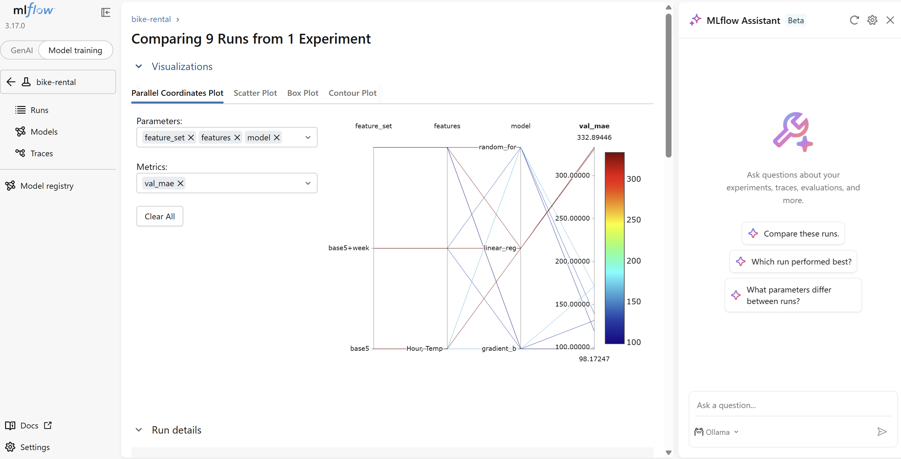
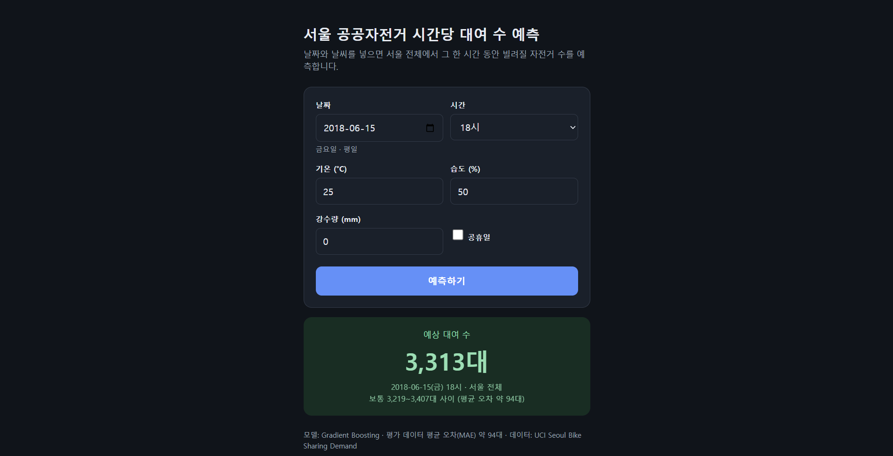
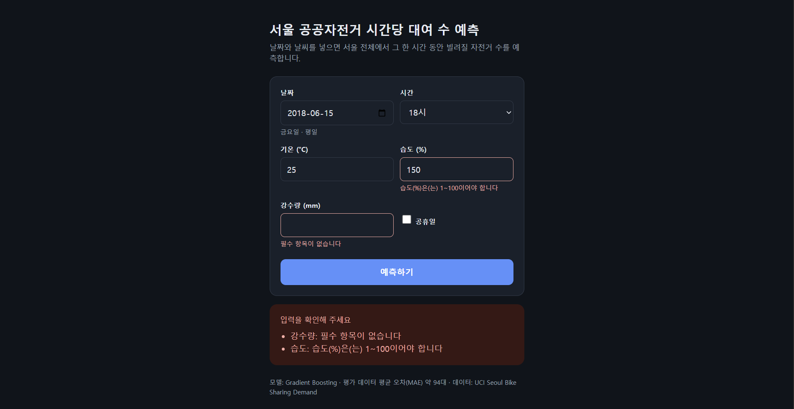

# cloud-mlops-team-1

서울 따릉이 시간별 대여 기록과 날씨 데이터로 **서울 전체의 시간당 대여 수**를 예측하는 서비스로, 따릉이 운영 상황실 근무자가 비·공휴일처럼 수요가 바뀌는 날 아침에 상황실 화면에서 시간대별 예상 대여 수를 확인해 그날 거리에 내보낼 자전거 수를 정하는 데 쓴다.

- 데이터 설명·전처리 규칙: [`data/README.md`](data/README.md)
- 입력(7개): Hour, Temperature(°C), Humidity(%), Rainfall(mm), is_offday(쉬는 날 = 주말 또는 공휴일), month(월), dow(요일)
  - is_offday·month·dow는 날짜와 공휴일 여부에서 계산하므로 사용자는 날짜와 공휴일 여부만 알면 된다.
- 정답: Rented Bike Count (시간당 대여 수, 단위: 대)

## 폴더 구조

```
data/raw/              # 원본 CSV (수정하지 않음)
data/processed/        # 전처리 결과 (정제·격리·기록)
docs/                  # 열 역할·처리 규칙, 수동 확인 결과, 캡처, 주차별 학습지
src/preprocess.py      # 전처리
src/train.py           # 학습·검증·평가, MLflow 기록, 모델 저장
src/predict.py         # 입력 검사·예측 함수
src/api.py             # FastAPI 서버 (/, /health, /predict, /feedback)
src/event_log.py       # 예측·피드백 JSON 로그, CloudWatch 전송
src/check_api.py       # API 정상·오류 요청 확인
src/sample_rows.py     # 수동 확인용 평가 데이터 샘플 추출
web/index.html         # 예측 웹페이지
models/model.joblib    # 학습된 모델
results/               # 평가 결과, API 확인 결과
```

## 실행 방법

저장소 최상위 폴더에서 실행한다.

```sh
# 1. 가상환경과 라이브러리 설치 (처음 한 번)
python3 -m venv .venv
.venv/bin/pip install -r requirements.txt

# 2. 전처리: data/raw → data/processed
python3 src/preprocess.py

# 3. 학습·평가: models/model.joblib, results/metrics.json 생성
.venv/bin/python src/train.py
```

## 학습 방법

- 입력: `data/processed/bike-clean.csv` (8,448행)
- Date로 주말 여부 `is_weekend`(토·일=1), 월 `month`(1~12), 요일 `dow`(월=0~일=6)를 계산하고, Holiday는 숫자로 바꾼다 (Holiday=1).
- 쉬는 날 `is_offday` = 주말 또는 공휴일. 공휴일은 17일뿐이라, 주말과 합치면 공휴일이 주말 데이터를 빌려 배울 수 있다.
- 학습 60% / 검증 20% / 평가 20%로 랜덤 분할한다 (`random_state=42` 고정).
- 입력 5가지 × 모델 3개(선형회귀, 랜덤포레스트, Gradient Boosting) = 15개 실험을 **검증용**으로 비교해 고른다.
- 고른 모델은 **평가용으로 마지막에 한 번만** 채점한다.
- 모든 실험은 MLflow에 기록한다 (`.venv/bin/mlflow ui` → http://127.0.0.1:5000).

## 결과

MAE는 평균적으로 몇 대 틀렸는지를 뜻한다.

### 검증용 비교 (MAE, 단위: 대)

| 입력 | 선형회귀 | 랜덤포레스트 | Gradient Boosting |
|---|---:|---:|---:|
| 5개 | 332.89 | 171.58 | 171.01 |
| + 주말 | 332.63 | 139.11 | 131.32 |
| + 주말 + 월 | 330.73 | 119.04 | 98.17 |
| + 주말 + 월 + 요일 | 330.66 | 116.88 | 91.01 |
| **쉬는 날 + 월 + 요일** (공휴일·주말 대신) | 330.63 | 113.19 | **90.84 (선택)** |



(캡처는 입력 3가지·9개 실험 시점의 화면이다.)

### 평가용 최종 결과 (선택한 모델, 1회)

| 항목 | 값 |
|---|---:|
| MAE | 85.11대 |
| 기준선 대비 개선 | 83.6% |
| R² | 0.951 |

이전 선택(주말 + 월, 평가 MAE 94.30대·R² 0.942)보다 오차가 약 10% 줄었다. 특히 공휴일 예측이 좋아졌다 ([`docs/manual-check.md`](docs/manual-check.md) 참고).

### 한계

- 시간 순서가 아닌 랜덤 분할을 사용했다. 데이터가 1년치라 같은 달의 데이터가 학습·검증·평가에 섞이므로, 실제 서비스(미래 예측)보다 점수가 좋게 나올 수 있다.
- 학습에 쓴 날씨는 관측값이다. 실제 서비스에서는 예보값을 입력하게 되므로 오차가 더 커질 수 있다.
- 수동 확인 결과와 개선 포인트는 [`docs/manual-check.md`](docs/manual-check.md)에 있다.

## 모델 직접 테스트

```sh
.venv/bin/python -c "
import joblib, pandas as pd
model = joblib.load('models/model.joblib')
cols = list(model.feature_names_in_)  # ['Hour', 'Temperature(°C)', 'Humidity(%)', 'Rainfall(mm)', 'is_offday', 'month', 'dow']
x = [18, 25, 50, 0, 0, 6, 4]  # [시간, 기온, 습도, 강수량, 쉬는 날(1/0), 월(1~12), 요일(월=0~일=6)]
print('예측 대여 수:', round(model.predict(pd.DataFrame([x], columns=cols))[0]), '대')
"
```

## 예측 API

### 실행

저장소 최상위 폴더에서 실행한다.

```sh
.venv/bin/uvicorn src.api:app
```

Windows: `.\.venv\Scripts\python.exe -m uvicorn src.api:app`

- `GET /health`: 서버·모델 상태
- `POST /predict`: 예측 (응답에 `request_id`)
- `POST /feedback`: 실제 대여 수 기록 → 재학습·강화학습용 로그 ([`docs/logging.md`](docs/logging.md))
- 테스트 화면: http://127.0.0.1:8000/docs

### 요청과 응답

요청 (`POST /predict`)

```json
{"date": "2018-06-15", "hour": 18, "temperature": 25.0, "humidity": 50, "rainfall": 0.0, "holiday": false}
```

정상 응답 (200)

```json
{"predicted_rentals": 3266, "unit": "대", "request_id": "63ceff91-1496-4750-b469-dfe7965e6847"}
```

입력 오류 응답 (422)

```json
{"errors": [{"field": "hour", "reason": "시간(0~23 정수)은(는) 0~23이어야 합니다"}]}
```

### 입력 규칙

| 항목 | 규칙 |
|---|---|
| date | YYYY-MM-DD (주말 여부·월은 서버가 계산) |
| hour | 0~23 정수 |
| temperature | -20~40 (°C) |
| humidity | 1~100 (%) |
| rainfall | 0~40 (mm) |
| holiday | true / false |

숫자처럼 생긴 문자열(`"25"`)과 true/false는 숫자로 받지 않는다.

기온·강수량 범위는 학습 데이터에 실제로 있던 범위(기온 -17.8~39.4°C, 강수량 0~35mm)에 맞췄다. 범위 밖 값은 모델이 배운 적이 없어 끝값과 같은 예측만 나오기 때문이다.

### 정상·오류 확인 결과

서버를 켠 상태에서 `.venv/bin/python src/check_api.py`로 실제 요청을 보내 확인했다. 모델 준비 실패는 `MODEL_PATH=models/no-model.joblib`로 서버를 켠 뒤 `--cases model-missing`으로 확인했다. 응답 원문은 `results/api-check.json`, `results/api-check-model-missing.json`에 있다.

| 상황 | 상태 코드 | 응답 |
|---|---:|---|
| 서버 상태 확인 | 200 | `status: ok` |
| 정상 입력 | 200 | 예측 3,266대 |
| 시간 25 | 422 | hour 범위 오류 |
| 습도에 문자 | 422 | humidity 숫자 아님 |
| 강수량 누락 | 422 | rainfall 필수 항목 없음 |
| 모델 파일 없음 | 503 | 모델을 읽지 못함 |
| 피드백 정상 | 200 | `matched: true`, `reward: -266` |
| 피드백 모르는 id | 200 | `matched: false`, 실제값만 기록 |
| 피드백 음수 | 422 | actual_rentals 범위 오류 |
| 피드백 id 누락 | 422 | request_id 필요 |

## 예측 웹페이지

API 서버를 켜고 브라우저에서 http://127.0.0.1:8000/ 을 연다.

- 날짜, 시간, 기온, 습도, 강수량, 공휴일을 입력하고 **예측하기**를 누르면 `/predict`를 호출해 예상 대여 수를 보여 준다.
- 시간은 00~23시 중에서 고르고, 날짜를 고르면 요일과 주말 여부가 바로 표시된다.
- 결과에는 평가 데이터 평균 오차(약 85대)를 바탕으로 한 예상 범위를 함께 보여 준다.
- 입력이 잘못되면 해당 칸을 빨갛게 표시하고, 서버가 돌려준 오류 이유를 보여 준다.
- 코드: `web/index.html` (서버의 `GET /`가 이 파일을 돌려준다)

| 입력 | 화면 결과 |
|---|---|
| 정상 입력 (2018-06-15 금 18시) | 예상 대여 수 3,266대 (보통 3,181~3,351대) |
| 공휴일 체크 | 예상 대여 수 2,438대 |
| 습도 150 | 습도 칸 빨간 테두리 + "1~100이어야 합니다" |
| 강수량 빈칸 | 강수량 칸 빨간 테두리 + "필수 항목이 없습니다" |

(캡처는 이전 모델 시점의 화면이라 숫자가 위 표와 다르다.)



## 예측·피드백 로그 (CloudWatch)

예측·피드백·입력 오류를 JSON 한 줄씩 콘솔에 남기고, `CLOUDWATCH_LOG_GROUP`을 설정하면 CloudWatch Logs에도 보낸다. 로그 형식, state/action/reward 정의, S3 내보내기 절차는 [`docs/logging.md`](docs/logging.md)에 있다.
